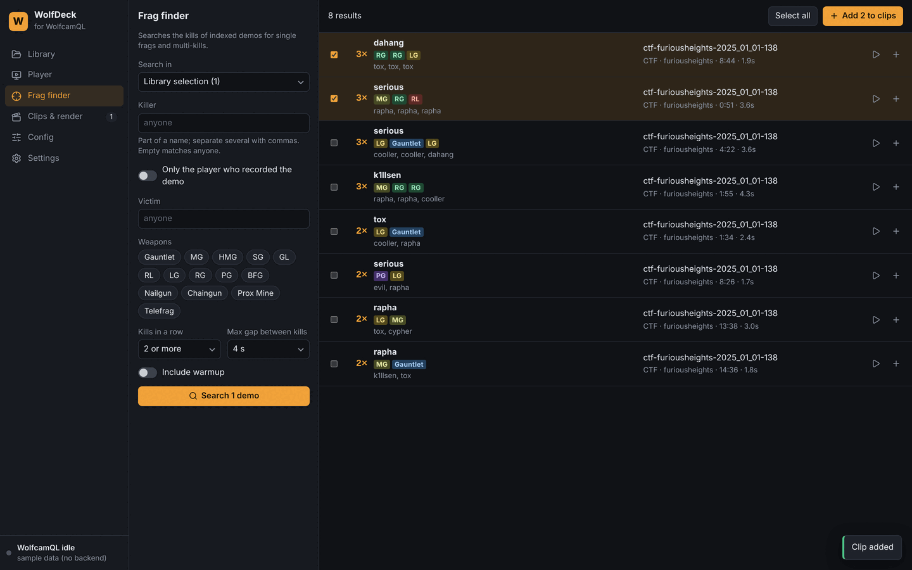

# WolfDeck

A desktop front end for [WolfcamQL](https://github.com/brugal/wolfcamql), the Quake Live / Quake 3 demo player. It covers what Wolf Whisperer did (demo organiser, media-player style playback control, recording and encoding, settings GUI, camera tools, voice-over demos) and adds a demo parser, a frag finder, a clip list with unattended batch rendering, and config profiles.

WolfDeck does not include or modify WolfcamQL. It starts the WolfcamQL you already have and drives it through its command line, config files and console commands.

Built with [Tauri 2](https://tauri.app) (Rust backend, React + TypeScript UI). Runs on Windows, Linux and macOS.


| Player | Frag finder | Clips & render |
| --- | --- | --- |
|  |  |  |

Screenshots show the built-in sample data.

## Features

**Library**
- Indexes any number of demo folders (recursively). Reads Quake Live `.dm_73`, `.dm_90`, `.dm_91` and Quake 3 `.dm_66`–`.dm_71` directly: map, mode, server, date, players, who recorded it, length, every kill and the chat.
- Search across file name, map, players, server, tags and notes; filter by mode, map, tag, favourites; sort by any column.
- Favourites, tags and notes per demo. Rename, move, delete to the recycle bin, show in folder.
- Per-demo kill timeline, kill list, player list with kills/deaths, chat log. Play from any kill or from any player's point of view.

**Player** (remote control for a running WolfcamQL)
- Play/pause, seek ±5 s / ±30 s, click-to-seek timeline with kill markers, previous/next kill, speed 0.1× to 8×.
- Follow any player, the killer or the victim; free camera; third person; HUD, weapon, crosshair toggles; frag forward.
- Camera tools: add/clear/play camera points, save and load camera files, record and replay movement paths.
- Mark in/out and add the range to the clip list; "record now" for quick captures.
- Voice-over: attach an audio file to a demo and it plays in sync with the demo position.
- Console with history, WolfcamQL log output, and your own quick-command buttons.

**Frag finder**
- Searches the kills of the whole library or a selection: by killer, victim, weapons, number of kills in a row and the gap allowed between them.
- Play a result to check it, or add one or many to the clip list.

**Clips & render**
- Clip list with editable name, start/end and point of view.
- Capture presets: resolution (up to 4K, vertical and square included), frame rate, motion blur, AVI codec or image sequences, optional depth pass, extra cvars.
- Unattended batch render: WolfcamQL is started once per clip, records exactly the clip and quits.
- Optional ffmpeg encode per clip: H.264, H.264 for YouTube, H.265, ProRes 422 HQ, DNxHR HQ, FFV1, or your own arguments. Progress per clip, cancel at any time.

**Config**
- Profiles (for example "Viewing" and "Movie") made of typed settings: view, HUD, players, effects, graphics, audio, plus free-form extra commands.
- A profile only sets what you tell it to; everything else stays as it is in your own WolfcamQL config.
- Export a profile as a `.cfg` file.

**Setup**
- Detects WolfcamQL, Quake Live (Steam) and ffmpeg where it can.
- Checks that WolfcamQL has the Quake Live pak files and copies missing ones ("Sync paks").

## Requirements

- WolfcamQL 12 or newer, with the Quake Live pak files in its `baseq3` (WolfDeck can copy them from a Quake Live install).
- ffmpeg, only if you want renders encoded to MP4/MOV/MKV.
- Windows 10/11 (WebView2, preinstalled on current Windows), Linux with WebKitGTK 4.1, or macOS.

## Getting it

Every push builds installers for Windows, Linux and macOS in GitHub Actions (workflow `build`); download them from the run's artifacts.

To build it yourself you need Node 20+ and Rust, plus the [Tauri prerequisites](https://tauri.app/start/prerequisites/) for your platform:

```bash
npm install
```

```bash
npm run tauri build
```

For development, `npm run tauri dev` starts the app with hot reload. `npm run dev` alone serves the UI in a browser with generated sample data and a simulated WolfcamQL, which is enough for UI work.

## First run

1. Open **Settings**, set the WolfcamQL executable, and add your demo folders. If the status box reports missing paks, set the Quake Live folder and press **Sync paks**.
2. In **Library**, double-click a demo to play it. The **Player** view becomes the remote control.
3. Add clips from a kill, from the **Frag finder**, or with Mark in / Mark out. Render them in **Clips & render**.

## How it controls WolfcamQL

WolfcamQL has no remote-control interface, so WolfDeck uses what the engine provides. Everything it writes goes into a `wolfdeck` folder inside WolfcamQL's home `wolfcam-ql` folder.

- **Launch**: the command line only carries the home path, the demo and two `exec`s. Settings that must be in place before the demo loads go into `wolfdeck/pre.cfg`; everything else into `wolfdeck/session.cfg`, which runs once the demo has loaded. (The engine limits its command line to 1023 characters.)
- **Live commands**: each batch of commands is written to a small cfg file listed in `wolfdeck/cmd.cfg`, guarded by a sequence number so a batch runs exactly once. The engine is then told to execute `cmd.cfg`:
  - on Linux and macOS through the engine's command pipe (`com_pipefile`);
  - on Windows, where the engine has no pipe or stdin console, by posting a key press to the WolfcamQL window. WolfDeck binds that key (default F13, changeable in Settings) to `execq wolfdeck/cmd.cfg`.
- **Feedback**: WolfcamQL is started with `logfile 2`, and WolfDeck reads `qconsole.log`.
- **Renders**: a clip is recorded with the engine's own timed commands (`seekservertime`, `at <time> video …`, `at <time> stopvideo`, `at <time> quit`), using demo server times taken from WolfDeck's parser.

Things to know:

- WolfcamQL saves changed cvars and binds to its own `q3config.cfg` as usual, so profile settings, the Windows control-key bind and `com_pipefile` persist there.
- The position shown in the Player is an estimate. It is exact after every seek made from WolfDeck; if you seek with WolfcamQL's own keys, press **Sync position**.
- On Windows, live commands do not arrive while WolfcamQL's console or a menu is open, because the engine does not run key binds then.
- While its window is focused, WolfcamQL captures the mouse. Alt-Tab back to WolfDeck, or use **Mouse capture** in the Player to turn that off.

## Status and testing

- The Rust backend has unit tests, plus parser tests against an excerpt of a real Quake Live demo. Kill counts and match start/end times were compared with WolfcamQL's own demo pre-parse on full demos (protocols 68 and 73).
- `src-tauri/tests/engine.rs` drives a real WolfcamQL: live command delivery (each batch exactly once), seeking by server time, capture and ffmpeg encode. It was run on Linux against WolfcamQL 12.7test53 built from source. It is skipped unless the `WOLFDECK_TEST_*` variables described in that file are set.
- Not yet verified on real hardware: the Windows key-press command channel (it compiles in CI, but has not been exercised against WolfcamQL on Windows), macOS, and demos of protocol 90 and 91 (the field tables follow the WolfcamQL source, but no sample demos were available).

## Licence

GPL-2.0-or-later. The demo decoding tables (network fields and the Huffman table) are derived from the ioquake3 / WolfcamQL source, which is GPL. The test fixture `src-tauri/tests/fixtures/ffa-excerpt.dm_73` is the first minute of a sample demo distributed with WolfcamQL.

WolfDeck is not affiliated with WolfcamQL, Wolf Whisperer, or id Software.
