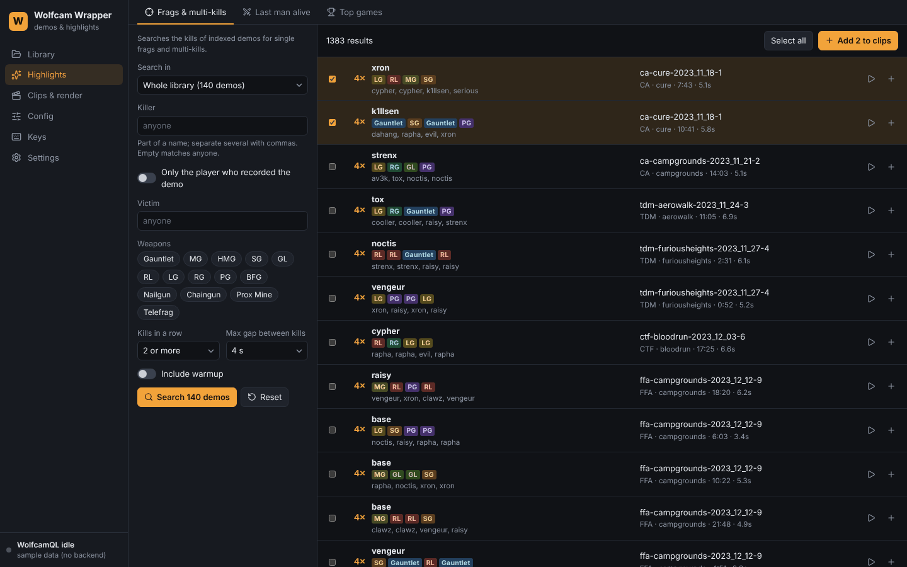
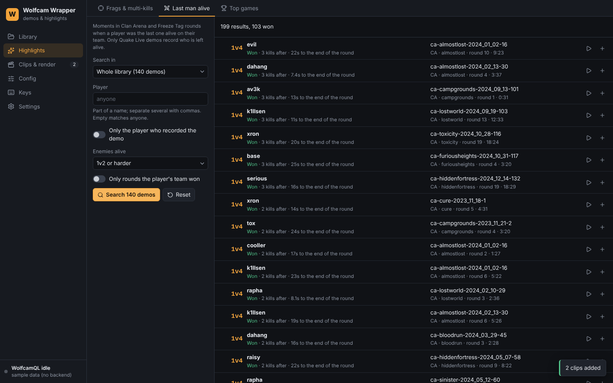
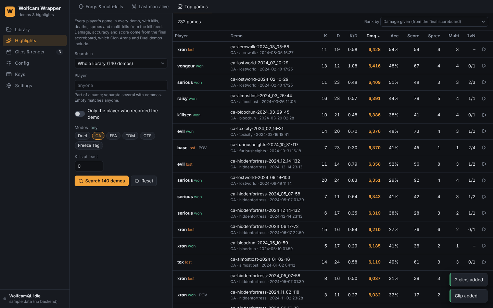
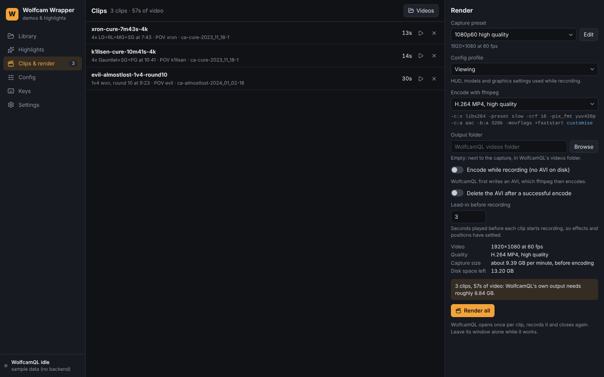
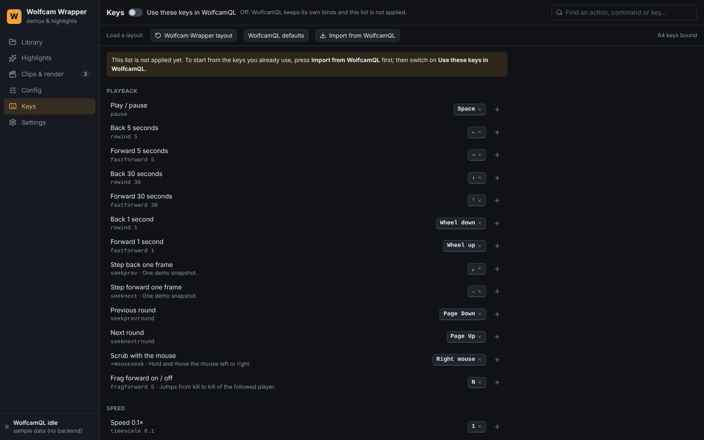

# Wolfcam Wrapper

A demo library and highlight finder for [WolfcamQL](https://github.com/brugal/wolfcamql), the Quake Live / Quake 3 demo player. It reads your demos directly, so you can browse them, find the frags, last-man-alive rounds and best games in them, open any moment in WolfcamQL, and render clips. It also edits WolfcamQL's settings and key binds.

Wolfcam Wrapper does not include or modify WolfcamQL, and it does not remote-control it. It starts the WolfcamQL you already have at the moment you picked, following the player you picked, and leaves the rest to you. Clips are rendered by starting WolfcamQL once per clip with a script that records the clip and quits.

Built with [Tauri 2](https://tauri.app) (Rust backend, React + TypeScript UI). Runs on Windows and Linux. It was called WolfDeck up to 0.1.0-alpha.3.


| Frags & multi-kills | Last man alive | Top games |
| --- | --- | --- |
|  |  |  |

| Clips & render | Config | Keys |
| --- | --- | --- |
|  |  |  |

Screenshots show the built-in sample data.

## Features

**Library**
- Indexes any number of demo folders (recursively). Reads Quake Live `.dm_73`, `.dm_90`, `.dm_91` and Quake 3 `.dm_66`–`.dm_71` directly: map, mode, server, date, players, who recorded it, length, every kill, the chat, the rounds of Clan Arena and Freeze Tag, and the final scoreboard.
- Search across file name, map, players, server, tags and notes; filter by mode, map, tag, favourites; sort by any column.
- Flags demos whose map WolfcamQL does not have (checked against the pak files it can load, including Steam Workshop content), with a filter to list them.
- Favourites, tags and notes per demo. Rename, move, delete to the recycle bin, show in folder.
- Per demo: kill timeline, kill list, players with kills/deaths (and damage and accuracy where the scoreboard has them), rounds with their winners and last-man-alive moments, and the chat. Open WolfcamQL at any kill, round or player's point of view.

**Highlights**
- **Frags & multi-kills**: searches the kills of the whole library or a selection by killer, victim, weapons, number of kills in a row and the gap allowed between them.
- **Last man alive**: every moment in Clan Arena and Freeze Tag rounds when a player was the last one alive on their team, with the number of enemies left (1v1 to 1v5), whether the round was won, and the kills made from then on. Won rounds come first, hardest odds first.
- **Top games**: one row per player per demo with kills, deaths, K/D, best spree, best multi-kill and last-man-alive rounds won, plus damage, accuracy and score from the final scoreboard (Clan Arena and Duel). Rank by any column; filter by player, mode and minimum kills.
- Open any result in WolfcamQL at that moment, following the player, or add it to the clip list. The searches keep their filters and results while you look elsewhere.

**Clips & render**
- Clip list with editable name, start/end and point of view, a per-clip speed for slow motion, and per-clip extra commands.
- Capture presets: resolution (up to 4K, vertical and square included), frame rate, motion blur, AVI codec or image sequences, optional depth pass, extra cvars.
- Unattended batch render: WolfcamQL is started once per clip, records exactly the clip and quits.
- Optional ffmpeg encode per clip: H.264, H.264 for YouTube, H.265, ProRes 422 HQ, DNxHR HQ, FFV1, or your own arguments. Progress per clip, cancel at any time.
- Encode while recording: WolfcamQL streams the capture straight into ffmpeg, so no large AVI is written first.
- Clips are kept inside the demo (a clip that runs past the demo's end is shortened), and a capture that stops making progress is ended with an error instead of waiting forever.
- Shows the capture size per minute and the free disk space, and warns when a batch will not fit.

**Config**
- Profiles (for example "Viewing" and "Movie") made of typed settings: view, HUD, frag messages, players, effects, overlays, graphics, audio, plus free-form extra commands. The profile in use is applied each time a demo is opened or a clip rendered.
- HUD chooser: Quake Live HUD, compact HUD, Quake 3 HUD, or a custom `.menu` file. Position of the watched player's name.
- Frag message editor with the token reference (`%v`, `%k`, `%i` ...), position, scale, colour and display time.
- Settings the engine only applies after `vid_restart` are marked; opening a demo or rendering does the restart when needed.
- A profile only sets what you tell it to; everything else stays as it is in your own WolfcamQL config. The one exception is the demo taker's field of view (`cg_useDemoFov`), which is set to "ignore" unless a profile chooses otherwise, so the free camera does not zoom with the player.
- **Restore default profiles**, reset a single built-in profile, export a profile as a `.cfg` file.

**Keys**
- Shows every WolfcamQL key bind as an action with its keys: playback, speed, view, free camera movement, camera points, recording and loop, plus binds to any other console command.
- Assign a key by pressing it (keyboard, mouse buttons and wheel) or by choosing it from a list; a key that is already taken is shown with what it currently does.
- Layouts: the Wolfcam Wrapper layout (Space to pause, arrows and wheel to seek, number keys for speed, WASD free camera, camera tools on V / U / O / P / brackets), WolfcamQL's own defaults, or the binds imported from your WolfcamQL config.
- Off until you switch on "Use these keys in WolfcamQL". From then on this list is set each time a demo is opened. The binds WolfcamQL had before are kept and can be loaded again.

**Setup**
- Detects WolfcamQL, Quake Live (Steam) and ffmpeg where it can.
- Checks that WolfcamQL has the Quake Live pak files and copies missing ones ("Sync paks").
- Optional SteamCMD location, so WolfcamQL can download Steam Workshop maps a demo needs.

## Requirements

- WolfcamQL 12 or newer, with the Quake Live pak files in its `baseq3` (Wolfcam Wrapper can copy them from a Quake Live install).
- ffmpeg, only if you want renders encoded to MP4/MOV/MKV.
- Windows 10/11 (WebView2, preinstalled on current Windows) or Linux with WebKitGTK 4.1. macOS is not supported.

## Getting it

Download the installer for Windows or Linux from the [Releases](https://github.com/GurnHub/wolfcam-wrapper/releases) page. Releases are built by the `release` workflow, started either by pushing a version tag (for example `v0.2.0-alpha.1`) or from the Actions tab with the tag to create; the release text comes from `docs/releases/<tag>.md`. Every other push also builds installers in the `build` workflow, available as that run's artifacts.

Coming from WolfDeck: the new name is a separate app. On its first start it copies WolfDeck's settings, profiles, clips, key map and search forms from WolfDeck's data folder; WolfDeck itself can then be uninstalled.

To build it yourself you need Node 20+ and Rust, plus the [Tauri prerequisites](https://tauri.app/start/prerequisites/) for your platform:

```bash
npm install
```

```bash
npm run tauri build
```

For development, `npm run tauri dev` starts the app with hot reload. `npm run dev` alone serves the UI in a browser with generated sample data, which is enough for UI work.

## First run

1. Open **Settings**, set the WolfcamQL executable, and add your demo folders. If the status box reports missing paks, set the Quake Live folder and press **Sync paks**.
2. In **Library**, double-click a demo to open it in WolfcamQL, or select it to see its kills, players and rounds.
3. In **Highlights**, search the library for frags, last-man-alive rounds or top games. Open a result in WolfcamQL, or add it to the clip list and render it in **Clips & render**.

## How it starts WolfcamQL

Everything Wolfcam Wrapper writes goes into a `wolfcam-wrapper` folder inside WolfcamQL's home `wolfcam-ql` folder.

- The command line only carries the home path, the demo and two `exec`s (the engine limits it to 1023 characters). The config profile and capture settings go into `wolfcam-wrapper/pre.cfg`, executed before the demo loads.
- Start-up commands (the seek to the chosen moment, the player to follow, the key binds, a profile's extra commands) go into `wolfcam-wrapper/start.cfg`. `wolfcam-wrapper/session.cfg` waits for the demo to load before running it: with Quake Live `.dm_91` demos, WolfcamQL first checks the demo's Steam Workshop items, and commands run before that are lost.
- Renders record a clip with the engine's own timed commands (`seekservertime`, `at <time> video …`, `at <time> stopvideo`, `at <time> quit`), using demo server times from Wolfcam Wrapper's parser, and follow the engine's progress in its console log (`logfile 2`).
- Opening another demo closes the WolfcamQL that Wolfcam Wrapper opened before. Closing Wolfcam Wrapper leaves WolfcamQL open.

## Status and testing

- The Rust backend has unit tests, including the round, last-man-alive and scoreboard decoding, plus parser tests against an excerpt of a real Quake Live demo. Rounds, winners, last-man-alive moments and scoreboards were checked against the server's own round results and statistics in real Clan Arena and Duel `.dm_91` demos.
- `src-tauri/tests/engine.rs` runs a real WolfcamQL: opening a demo at a time and following a player (also with `.dm_91` demos), a custom HUD from the profile, key binds (applied at launch, triggered by a real key press, read back from the engine's config), capture and ffmpeg encode, slow-motion and encode-while-recording renders, and a clip that runs past the end of the demo. It was run on Linux against WolfcamQL 12.7test53 built from source. It is skipped unless the `WOLFCAM_WRAPPER_TEST_*` variables described in that file are set.
- Not yet verified: the Windows app against a real WolfcamQL, and `.dm_90` demos (the field tables follow the WolfcamQL source, but no sample demos were available).

## Licence

GPL-2.0-or-later. The demo decoding tables (network fields and the Huffman table) are derived from the ioquake3 / WolfcamQL source, which is GPL. The test fixture `src-tauri/tests/fixtures/ffa-excerpt.dm_73` is the first minute of a sample demo distributed with WolfcamQL.

Wolfcam Wrapper is not affiliated with WolfcamQL, Wolf Whisperer, or id Software.
